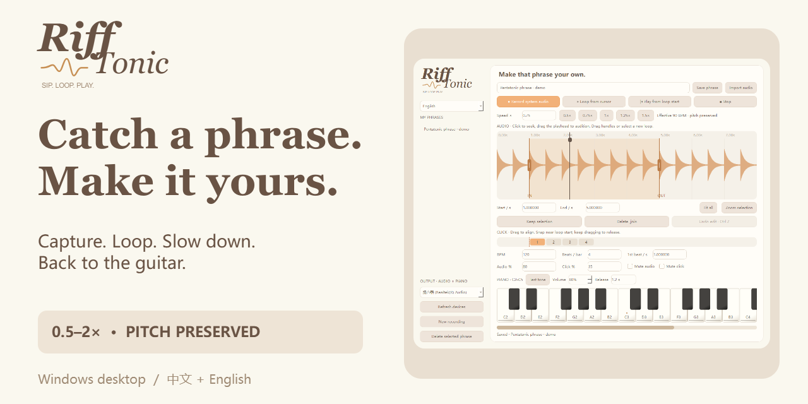
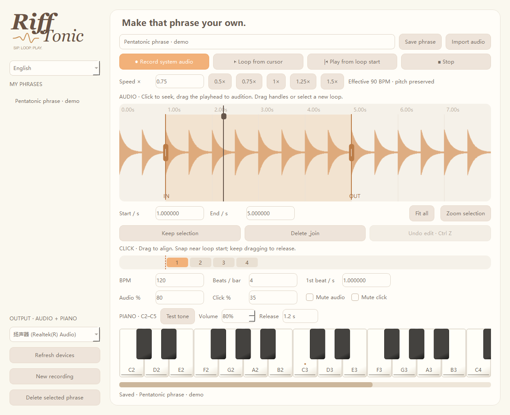

# Riff Tonic

**[⬇ Download for Windows](https://github.com/Kanecc3421/riff-tonic/releases/download/Riff-Tonic-v0.8.1/RiffTonic-Windows-v0.8.1-local.zip)**　 **[⬇ Download Android APK](https://github.com/Kanecc3421/riff-tonic/releases/download/Riff-Tonic-v0.8.1/RiffTonic-Android-v0.1.0.apk)**

Windows: extract the **entire ZIP**, then run `RiffTonic.exe` alongside its `_internal` folder. Android: install the APK on an Android-compatible phone; tested by the developer on Huawei HarmonyOS 4.2. The Android version currently omits the piano. **Code → Download ZIP contains source code, not a ready-to-run app.**

**One phrase. A little slower. Back to the guitar.**

A Windows desktop practice companion for learning riffs by ear: capture what your computer plays, loop a phrase, slow it down without changing pitch, and check a note on the piano.

[简体中文](README.zh-CN.md) · Version 0.8.1 · Windows 10 / 11



## A small workflow for a stubborn phrase

1. Play a reference through your default Windows output and record it, or import an audio file.
2. Drag across the waveform to set A–B. Seek, crop, or delete a selection; undo an edit if needed.
3. Slow playback to 0.5× and work back toward the original tempo. Pitch stays unchanged.
4. Set the BPM and first beat yourself, enable beat snapping, and balance the metronome against the recording.
5. Check pitches with the mouse piano, then save the phrase for your next session.



## What it does

- WASAPI system-output capture, with an output-device dropdown and rescan button.
- A–B loops and waveform editing with undo.
- Pitch-preserving playback from 0.5× to 2× using Pedalboard / Rubber Band.
- Adjustable first-beat offset, beat snapping, metronome, and separate audio / click / piano volumes.
- Horizontally scrollable C2–C5 mouse piano with a 0.3–3 second note tail.
- Local phrase library that remembers phrase settings and restores playback paused.
- Persistent English / Simplified Chinese interface switching.
- FFmpeg import for WAV, MP3, FLAC, M4A, AAC, OGG, WMA, AIFF and other supported audio containers.

Capture is limited to **10 minutes** per take; imports to **15 minutes** per file. This version does not detect BPM, generate tabs, transcribe with AI, or provide MIDI input.

## Download and run

Once published, open **this repository’s Releases** and download the Windows package for v0.8.1. Extract the entire archive and run `RiffTonic/RiffTonic.exe`; keep its accompanying files together. Python is not required for the packaged build.

This is an early desktop release. If capture is silent, confirm the Windows default output device, rescan devices in the app, and select the output that is actually playing. Headphone and Bluetooth device changes may require another rescan. Capture records system playback; other application sounds can be included.

## Run from source

Use Windows and Python 3.14:

```powershell
py -3.14 -m venv .venv
.venv\Scripts\python -m pip install -r requirements.txt
.venv\Scripts\python app.py
```

Run the automated suite:

```powershell
$env:QT_QPA_PLATFORM = 'offscreen'
.venv\Scripts\python -m unittest discover -s tests -p "test_*.py" -v
```

CI runs this suite on Windows. Actual output capture and audible playback still need a real Windows audio device and a listening check.

## Your phrases stay local

Phrase audio and metadata are stored under `%LOCALAPPDATA%\RiffLoop\phrases`. The folder keeps the original internal project name for continuity. Back it up before moving machines or removing data. Only record and share audio you have permission to use.

## Feedback and contributions

Open an issue with your Windows version, app version, output device, steps to reproduce, and expected / actual behavior. Use a short recording you have permission to share when audio is needed. Pull requests should describe the user-visible change and the checks performed.

## License

Riff Tonic source is offered under **GPL-3.0-or-later**. See [LICENSE](LICENSE) and [third-party notices](THIRD_PARTY_NOTICES.md). Dependencies retain their own licenses. Binary redistribution must also satisfy the licenses of the bundled components; release preparation notes are in [the publication checklist](publication/text/upload-checklist.md).
