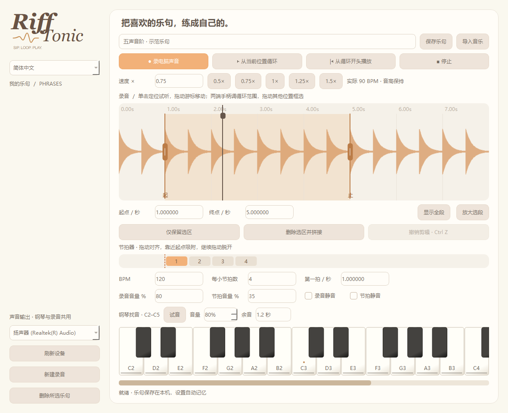

# Riff Tonic

**[⬇ 下载 Windows 版](https://github.com/Kanecc3421/riff-tonic/releases/download/Riff-Tonic-v0.8.1/RiffTonic-Windows-v0.8.1-local.zip)**　 **[⬇ 下载 Android APK](https://github.com/Kanecc3421/riff-tonic/releases/download/Riff-Tonic-v0.8.1/RiffTonic-Android-v0.1.0.apk)**

Windows：**完整解压 ZIP**，保留 `_internal` 文件夹，再运行 `RiffTonic.exe`。Android：将 APK 传到兼容安卓应用的手机上安装；开发者已在华为 HarmonyOS 4.2 手机上试用。Android 版暂不包含钢琴。**Code → Download ZIP 是源码，直接使用请点上面的下载入口。**

**一句乐句，慢一点，再拿起吉他。**

一个 Windows 桌面扒带练习工具：录下电脑正在播放的声音，圈出难听清的那一句，降速不降调，再用小钢琴对音。

[English](README.md) · 版本 0.8.1 · Windows 10 / 11


## 从听不清到能跟上

1. 播放参考音频，录制 Windows 输出设备的声音；也可以直接导入音频。
2. 在波形上拖出 A–B 循环，定位、裁剪或删除选区；编辑后可以撤销。
3. 从 0.5 倍速慢练，再逐渐回到原速，音高保持不变。
4. 手动设置 BPM 和第一拍位置，开启节拍吸附，分别调节原音、节拍器和钢琴音量。
5. 用鼠标钢琴核对音高，保存乐句，下次从暂停状态继续。



## 功能与边界

- WASAPI 系统声音录制，输出设备下拉选择与重新扫描。
- 波形 A–B 循环、选区编辑与撤销。
- 0.5–2 倍速保调变速，基于 Pedalboard / Rubber Band。
- 可调第一拍、节拍吸附与节拍器。
- 可横向滚动的 C2–C5 鼠标钢琴，尾音可调为 0.3–3 秒。
- 本地乐句库，按乐句保存练习设置。
- 中英文界面切换，并记住语言选择。
- FFmpeg 音频导入，支持 WAV、MP3、FLAC、M4A、AAC、OGG、WMA、AIFF 等格式。

单次录制最长 **10 分钟**，单个导入文件最长 **15 分钟**。当前版本没有自动 BPM、自动六线谱、AI 转写或 MIDI 输入。

## 下载与启动

发布后，在本仓库的 **Releases** 页面下载 v0.8.1 Windows 压缩包。完整解压后运行 `RiffTonic/RiffTonic.exe`，请保留旁边的依赖文件。打包版不需要另装 Python。

这是早期桌面版本。录不到声音时，检查 Windows 默认输出设备，点击应用中的重新扫描，并选择实际播放声音的设备。更换耳机或蓝牙设备后可能需要重新扫描。录制会包含输出设备上其他应用发出的声音。

## 从源码运行

Windows / Python 3.14：

```powershell
py -3.14 -m venv .venv
.venv\Scripts\python -m pip install -r requirements.txt
.venv\Scripts\python app.py
```

自动测试方法见 [English README](README.md#run-from-source)。真实录音设备和听感仍需在 Windows 上人工验证。

## 本地数据

乐句音频和元数据位于 `%LOCALAPPDATA%\RiffLoop\phrases`。为兼容已有数据，文件夹保留了早期项目名。迁移电脑或清理数据前请先备份。仅录制和分享你有权使用的音频。

## 反馈与许可

反馈时请提供 Windows 版本、软件版本、输出设备、复现步骤及预期 / 实际结果。需要附音频时，请使用可以公开分享的短片段。

项目源码采用 **GPL-3.0-or-later**，参见 [LICENSE](LICENSE) 与 [第三方说明](THIRD_PARTY_NOTICES.md)。依赖保留各自许可证；发布二进制包还需满足其中所包含组件的许可条件。
